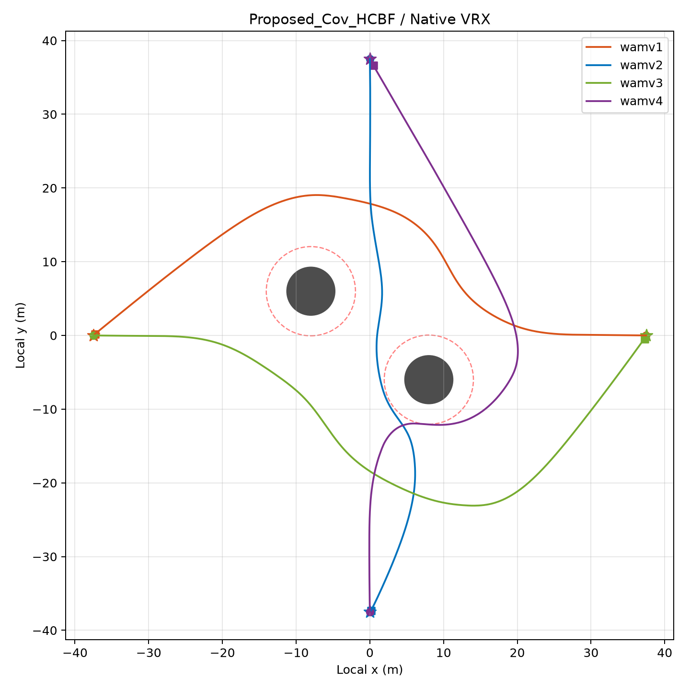

# Safety-Constrained Distributed Control Inference for Multi-ASV Collision Avoidance

This repository hosts the high-fidelity **VRX (Virtual RobotX) / Gazebo** physical validation results, numerical simulation benchmarks, and supplementary materials for the manuscript **"Safety-Constrained Distributed Control Inference for Multi-ASV Collision Avoidance"**.

> **📢 Note on Source Code:** 
> This repository currently provides the complete visual demonstrations, VRX physical validation telemetry, and quantitative ablation results for review purposes. **The full Python simulation engine (`GC01_TwoStage_HardMAP.py`) and ROS/VRX packages will be made publicly available upon the acceptance of the paper.**

---

## 1. Dynamic Simulation Videos

We validate the proposed **Safety-Constrained Distributed Factor Graph Inference (SC-DFGI)** framework across both high-fidelity 3D marine physical engines (ROS / Gazebo / Native VRX) and numerical dynamic simulations.

### 1.1 High-Fidelity VRX / Gazebo Physical Validation (`wamv1` – `wamv4`)
Real-time multi-ASV antipodal swap and static obstacle avoidance in the **VRX Sydney Regatta** environment ($t \in [0, 69.74]\text{ s}$), subject to 3D wave/hydrodynamic disturbances, full twin-hull WAM-V geometries, and differential thruster dynamics:

<!-- 👇 请在网页编辑模式下，直接用鼠标把你的 Gazebo验证.mp4 拖拽到下面这行空白处 👇 -->


### 1.2 Numerical Simulation & Ablation Animation
4 underactuated ASVs performing an antipodal swap in a workspace obstructed by static circular obstacles under exact 3-DOF nonlinear Fossen hydrodynamics:

<!-- 👇 请直接用鼠标把你的 纯数值仿真.mp4 (或 .gif) 拖拽到下面这行空白处 👇 -->


---

## 2. Native VRX / Gazebo Physical Validation Results (`./results/`)

In the high-fidelity VRX experiment, four full-scale underactuated twin-hull ASVs (`wamv1`, `wamv2`, `wamv3`, `wamv4`) are deployed in an antipodal configuration ($R \approx 37.5\text{ m}$) with two central cylindrical obstacles.

### 2.1 3D Motion History & Scene Snapshots

**Time-Lapse Composite Trajectory ($0\text{–}69.3\text{ s}$, sampled every $8.0\text{ s}$):**
<p align="center">
  
</p>

**Initial Configuration ($t = 0.00\text{ s}$) vs. Completed Antipodal Swap ($t = 69.74\text{ s}$):**
| Initial Scene ($t = 0.00\text{ s}$) | Final Scene ($t = 69.74\text{ s}$) |
| :---: | :---: |
|  |  |

---

### 2.2 2D Trajectory & Safety Clearance Profiles

Left: 2D trajectories in local coordinates showing smooth collision-free navigation around the obstacle safety envelopes (dashed red circles). Right: Pairwise inter-ASV clearances, obstacle clearances, hull gaps, and look-ahead point distances strictly satisfying the HCBF safety margins throughout the entire maneuver.

| 2D Local Trajectories (`Proposed_Cov_HCBF / Native VRX`) | Multi-Metric Safety Distances |
| :---: | :---: |
|  |  |

---

### 2.3 Control Filtering, Thruster Allocation & Velocity Profiles

**Nominal vs. Applied Control Commands ($\tau_u, \tau_r$):**
Comparison between the Stage-I nominal control belief (dashed gray) and the Stage-II HOCBF-QP filtered command (solid colored) for `wamv1`–`wamv4`, demonstrating minimally invasive safety intervention during peak conflict ($t \in [15, 42]\text{ s}$):
<p align="center">
  
</p>

**3-DOF Velocities ($u, v, r$) & Differential Thruster Forces ($T_{\text{left}}, T_{\text{right}}$):**
| Velocity Profiles (Planar, Surge $u$, Sway $v$, Yaw Rate $r$) | Left & Right Thruster Commands ($\text{N}$) |
| :---: | :---: |
|  |  |

---

## 3. Framework Overview

We propose a two-stage **Safety-Constrained Distributed Factor Graph Inference (SC-DFGI)** architecture:
- **Stage I (Distributed Factor Graph Variational Inference):** Infers nominal control beliefs via variational importance sampling and Gaussian moment matching over a local prediction horizon, integrating goal-tracking priors, 3-DOF nonlinear hydrodynamic transitions, static obstacle soft repulsion, and COLREGs-inspired inter-ASV interaction factors.
- **Stage II (Safety-Constrained MAP / Second-Order HOCBF-QP):** Enforces hard pairwise inter-ASV and obstacle collision avoidance constraints on a look-ahead point (relative degree 2) via symmetric responsibility splitting.

---

## 4. Repository Structure

```text
├── results/
│   ├── trajectory_composite.jpg   # 3D time-lapse motion history (8.0s intervals)
│   ├── scene_initial.jpg          # VRX initial deployment snapshot (t = 0.00s)
│   ├── scene_final.jpg            # VRX final completion snapshot (t = 69.74s)
│   ├── trajectories.png           # 2D trajectories & obstacle safety margins
│   ├── safety_distances.jpg       # Inter-boat & obstacle hull/look-ahead clearances
│   ├── control_inputs.jpg         # Nominal (Stage-I) vs. Applied (Stage-II) commands
│   ├── speeds.jpg                 # Planar speed, surge (u), sway (v), and yaw rate (r)
│   └── thrusters.jpg              # Port (left) and starboard (right) thruster forces
└── README.md
